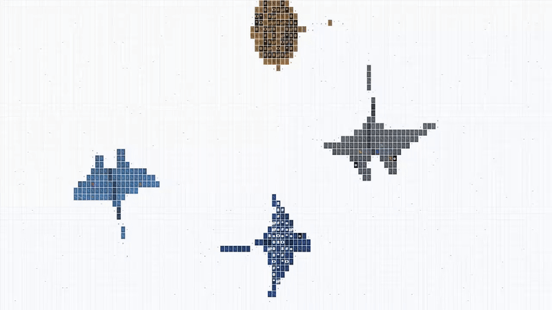

# ascii-manta-rays 🪽

> Majestic manta rays gliding in ASCII on HTML canvas with biomimetic pectoral wing oscillations. Zero dependencies.

```text
               .---.
              /     \
             /  / \  \
       .----'  (   )  '----.
      / :;t%SX8#| |#8XS%t;: \
     / :;t%SX8#@| |@#8XS%t;: \
    /  :;t%SX8#@| |@#8XS%t;:  \
   /   :;t%SX8#@| |@#8XS%t;:   \
  /    :;t%SX8#@| |@#8XS%t;:    \
 '-----'---.    | |    .---'-----'
            \   | |   /
             \  | |  /
              '-| |-'
                | |
                | |
                | |
                ' '
```



Aerodynamic and hydrofoil physics rendered entirely with monospace ASCII characters on an HTML `<canvas>`. Includes spanwise travelling waves along the pectoral wings, bank angle roll kinematics, escorting pilot fish / remoras, and four distinct ray species.

Inspired by [ascii-sharks](https://github.com/stackedlol/ascii-sharks).

---

## ✨ Features

- **Biomimetic Pectoral Wing Oscillations**: Sinusoidal undulations propagate along chordwise and spanwise wing dimensions, producing lift and thrust simultaneously.
- **Roll & Pitch Banking**: Mantas roll into turns realistically with banking angle proportional to angular yaw velocity.
- **Escort Remoras & Pilot Fish**: Remoras autonomously draft behind large mantas, adjusting proximity and reacting to acoustic ripples.
- **Species Roster**:
  - 🪽 **Giant Oceanic Manta** (*Mobula birostris*) — Massive triangular wing span, cephalic horns, charcoal body with white dorsal shoulder patches.
  - 🪽 **Spotted Eagle Ray** (*Aetobatus narinari*) — Distinct duckbill snout, angular pectoral wings, and white ring spots across deep navy skin.
  - 🪽 **Reef Manta Ray** (*Mobula alfredi*) — Elegant curved wingtips and luminescent steel-blue chevron markings.
  - 🪽 **Leopard Ray** (*Himantura uarnak*) — Broad rounded saucer disc with charcoal leopard rosettes over warm sand tones.
- **Zero Dependencies**: Pure Vanilla JS / TypeScript. Works directly via `mantas.js` or through modern build tools (Vite, Next.js).
- **Responsive & Accessible**: Auto-resizes, respects `prefers-reduced-motion`, and pauses when out of view.

---

## 🚀 Quick Start

### 1. Plain HTML (Zero Build Tools)

Drop `mantas.js` into any web page:

```html
<!doctype html>
<html>
  <head>
    <style>
      body { margin: 0; background: #000; overflow: hidden; }
      canvas { width: 100vw; height: 100vh; font-family: monospace; }
    </style>
  </head>
  <body>
    <canvas id="manta-bay"></canvas>

    <script src="mantas.js"></script>
    <script>
      const canvas = document.getElementById("manta-bay");
      const engine = new MantaEngine(canvas);
    </script>
  </body>
</html>
```

### 2. Modern Bundlers & TypeScript (Vite / Next.js)

```bash
npm install
npm run dev
```

```typescript
import { MantaEngine } from "ascii-manta-rays";

const canvas = document.querySelector("canvas")!;
const engine = new MantaEngine(canvas, [
  { kind: "giant_manta", size: 1.0 },
  { kind: "spotted_eagle", size: 0.9 },
  { kind: "reef_manta", size: 0.85 },
  { kind: "leopard_ray", size: 0.85 },
]);
```

### 3. React Component

```tsx
import { AsciiMantaRays } from "ascii-manta-rays/react";

export default function ReefView() {
  return (
    <div style={{ width: "100vw", height: "100vh", background: "#000" }}>
      <AsciiMantaRays
        mantas={[
          { kind: "giant_manta", size: 1.0 },
          { kind: "reef_manta", size: 0.9 },
        ]}
      />
    </div>
  );
}
```

---

## 🕹️ Interactive Controls & URL Parameters

You can customize the simulation directly via URL search parameters:

```text
http://localhost:5173/?mantas=giant_manta,spotted_eagle,reef_manta,leopard_ray
```

- **Click / Tap**: Generates acoustic pressure waves that startle escort fish and induce rapid wing flutter in nearby mantas.
- **Mouse Hover**: Mantas steer smoothly away from cursor proximity fields.

---

## 🧬 Aerodynamics & Flapping Wave Physics

1. **Spanwise Travelling Wave**: Pectoral lift is calculated as an oscillating spanwise spline:
   $$z(u, t) = A(u) \cdot \sin(\omega t - k u)$$
   where $u \in [0, 1]$ represents the normalized distance from the spine to wingtip.
2. **Coordinated Banking**: Turns apply centrifugal tilt: $\theta_{\text{roll}} = \text{clamp}(k_{\text{yaw}} \cdot \dot{\psi}, -\theta_{\max}, \theta_{\max})$.
3. **Drafting Dynamics**: Remoras execute a pursuit-evasion steering vector to position themselves within the low-pressure boundary layer beside the manta's pectoral roots.

---

## 📄 License

MIT © 2026 [Lazaro Guerrero Losada](https://github.com/lazaro-guerrero-losada)
